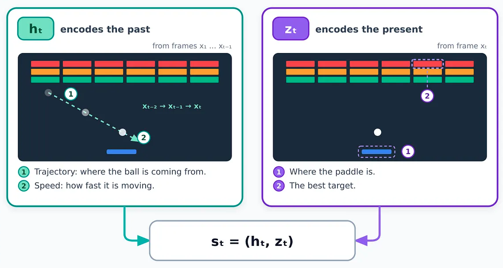
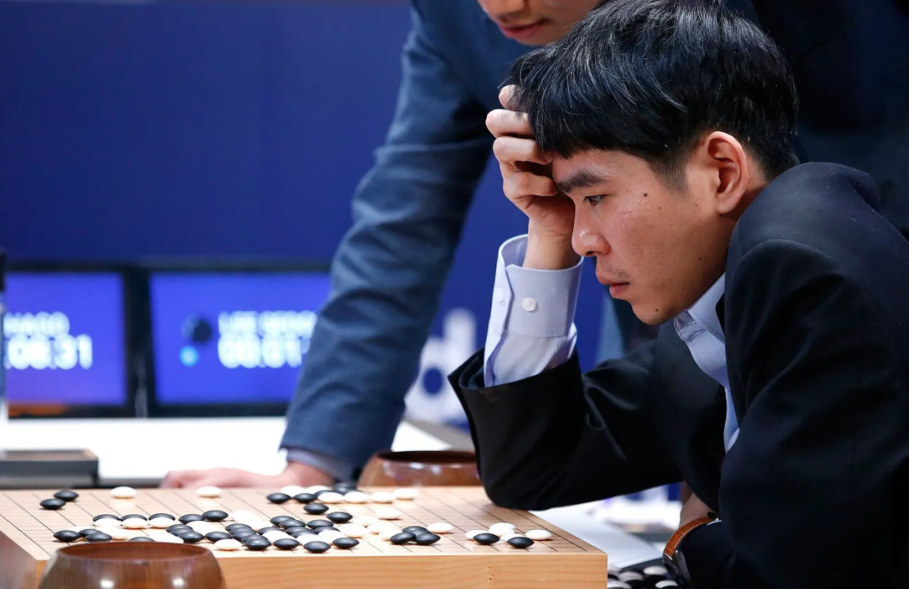
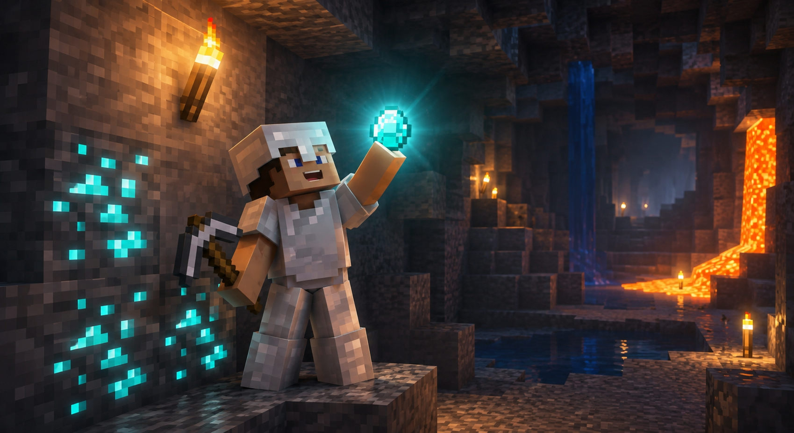

# Learning World Models

## Context

I am Guillermo, a **Data Scientist** who has spent most of his career building **Recommender Systems** and **Rankings**. Lately, however, I've been more interested in what people call **Physical AI**. As AI gets more capable, I think the next big step is getting it to act in the real world.

This is a viral quote that perfectly resonates with my thinking:

<i>"I want AI to do my laundry and dishes so that I can do art and writing, not for AI to do my art and writing so that I can do my laundry and dishes."</i> (<a href="https://x.com/AuthorJMac/status/1773679197631701238">Joanna Maciejewska</a>)

## Why DreamerV3

The problem was that I didn't know where to start. I have no experience in Robotics or Reinforcement Learning, so I was a bit lost. After doing some research, I found that one of the bottlenecks in Physical AI is **data collection**, and one of the ways to overcome this limitation is to use **World Models**, which basically allow you to predict how the environment changes given an agent's action.

That led me to the **DreamerV3** paper, [Mastering Diverse Domains through World Models](https://arxiv.org/abs/2301.04104), by researchers at DeepMind and the University of Toronto. It introduces an RL agent that uses a World Model to train on imagined sequences, and that outperformed specialised methods across more than 150 tasks with a fixed set of hyperparameters. Given how widely cited the paper was, and also out of the respect I have for DeepMind's work, it seemed like a great place to start.

However, understanding it proved harder than expected, probably because I was lacking some basic concepts about RL and World Models. This repository is my attempt to share **simplified explanations** that may be useful for anyone willing to learn more about Physical AI, without having any prior RL/Robotics experience. Writing them also helps me internalise the concepts and learn in the process.

## How to follow along

I will update this repo as I go with what I learned. The log below is kind of a **diary of the project**. Note that **I do not commit to a fixed schedule**, so updates will be irregular. Basically I plan to work on this whenever I have free time.

## Log

### September 18th, 2026

I have published my first Substack post: [**How DreamerV3 dreams**](https://guillelahuerta.substack.com/p/how-dreamerv3-dreams). It is a simplified guide to the World Model, using Atari's Breakout to explain the recurrent state, the stochastic representation, and how the model learns to imagine.

The post covers the World Model; the Critic and Actor are still to come on Substack.

### October 10th, 2026

I have published the second part of the series on Substack: [**How DreamerV3 dreams (Part II)**](https://guillelahuerta.substack.com/p/how-dreamerv3-dreams-part-ii). This one covers the Critic: the difference between rewards and returns, the 15-step imagined rollouts used as training data, the λ-returns, and the two-hot loss that allows using the same hyperparameters across different games.

### November 15th, 2026

I have published the third (and last) part of the series: [**How DreamerV3 dreams (Part III)**](https://guillelahuerta.substack.com/p/how-dreamerv3-dreams-part-iii). It covers the Actor: how its policy is trained on the same imagined rollouts as the Critic, the Advantage, the REINFORCE loss, the entropy regulariser that keeps it exploring, and the return normalisation.

## References

Some of the material that got me started, in case it is useful for someone else:

### Videos

- [Yann LeCun's $1B Bet Against LLMs, Part 1](https://www.youtube.com/watch?v=kYkIdXwW2AE&t=1738s) and [Part 2](https://www.youtube.com/watch?v=v_jDvpEGTIg&t=150s), by Welch Labs. On why LeCun thinks the next step for AI is World Models, not bigger LLMs.
- [Robotics' End Game: Nvidia's Jim Fan](https://www.youtube.com/watch?v=3Y8aq_ofEVs), by Sequoia Capital. On where robotics is going and the role of simulation and foundation models.
- [AlphaGo - The Movie](https://www.youtube.com/watch?v=WXuK6gekU1Y), by Google DeepMind. The documentary about the match against Lee Sedol, which I use in Part II to introduce the Critic.

### Blogposts

- [World Models](https://worldmodels.github.io/), by Ha and Schmidhuber (2018). The interactive article that made the term popular. An agent learns to drive and to play Doom inside its own dream.
- [World Models](https://rohitbandaru.github.io/blog/World-Models/), by Rohit Bandaru. A long technical tour of World Model architectures, including the RSSM used by Dreamer, and newer ones like JEPA, Genie and Cosmos.
- [Introducing GAIA-1](https://wayve.ai/thinking/introducing-gaia1/), by Wayve. A generative World Model for self-driving, and a good example of these ideas applied in industry.

### Papers

- [Mastering Diverse Domains through World Models](https://arxiv.org/abs/2301.04104), by Hafner et al. This is the DreamerV3 paper and the conceptual foundation of the study. The author's [project page](https://danijar.com/project/dreamerv3/) has the uncut videos of the Minecraft diamond runs.
